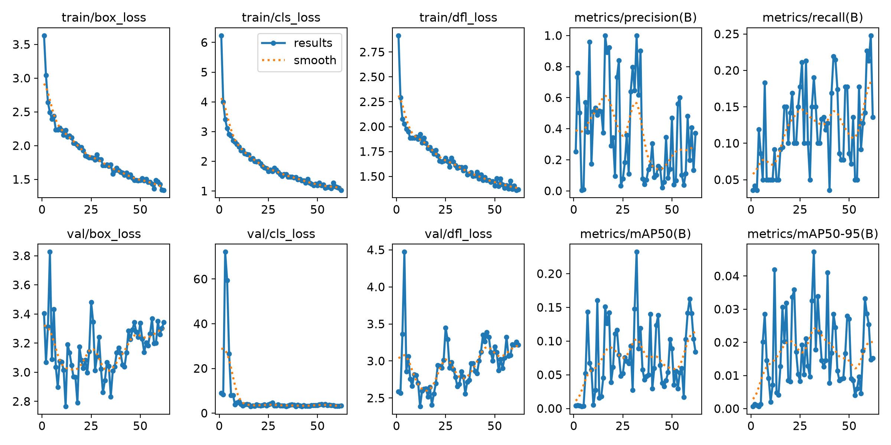
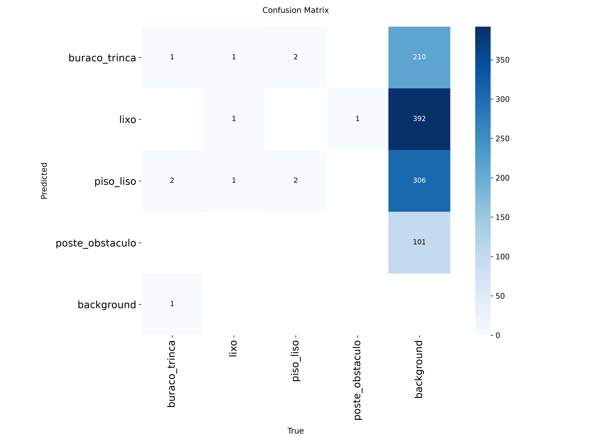
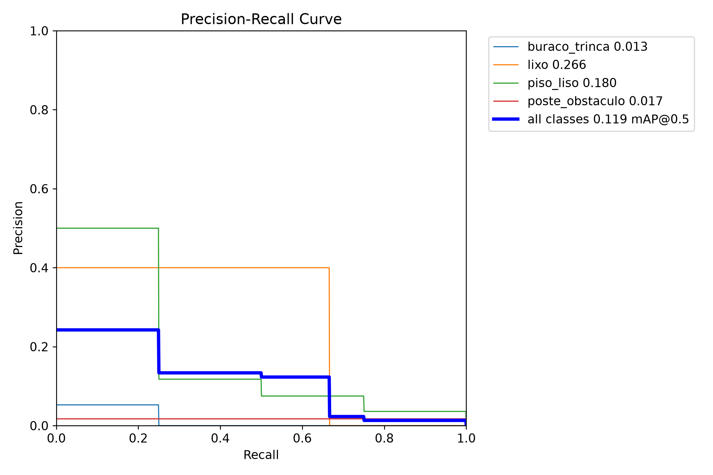

# Auditoria de Calçadas com YOLO — CPZÃO (CP2 + CP3)

Detecção de defeitos, obstáculos e elementos de acessibilidade em calçadas com **YOLOv8n**,
rodando em tempo real no celular via **yoloinferApp** (ONNX Runtime Web).

## Integrantes

| Nome | RM |
| :--- | :--- |
| Rodrigo | 550816 |

**Turma:** 4ESPG · **Instituição:** FIAP

## 1. Problema

A qualidade das calçadas e a acessibilidade urbana são desafios em grandes cidades. Este projeto
automatiza parte da auditoria de calçadas detectando, em imagens e em tempo real pela câmera do
celular, itens relevantes para a caminhabilidade e a acessibilidade.

Referência de metodologia: [Auditoria de Calçadas](https://falzoni.com.br/auditoriacalcadas/)

## 2. Classes

| ID | Classe | Descrição |
| :-: | :--- | :--- |
| 0 | `buraco_trinca` | Buracos, rachaduras e pisos danificados |
| 1 | `lixo` | Lixo, entulho e resíduos em circulação |
| 2 | `piso_liso` | Trechos lisos, de difícil aderência ou pavimento irregular |
| 3 | `poste_obstaculo` | Postes, placas, mobiliário ou outros obstáculos na faixa de passagem |

> Os nomes e a ordem dos IDs seguem o `dataset/data.yaml` final do Roboflow.

## 3. Dataset

- Fonte: notebook de aquisição do professor + projeto de referência
- Anotação: Roboflow (formato YOLOv8)
- Split atual: 212 imagens de treino, 21 de validação e 12 de teste

Estatísticas (saída de `python scripts/dataset_stats.py`):

| Split | Imagens | `buraco_trinca` | `lixo` | `piso_liso` | `poste_obstaculo` |
| :--- | ---: | ---: | ---: | ---: | ---: |
| Treino | 212 | 60 | 60 | 56 | 36 |
| Validação | 21 | 7 | 5 | 6 | 3 |
| Teste | 12 | 4 | 3 | 4 | 1 |
| **Total** | **245** | **71** | **68** | **66** | **40** |

## 4. Treinamento

- Modelo: `yolov8n.pt` (pré-treinado COCO)
- Hardware: NVIDIA RTX 4060
- Hiperparâmetros: até 100 épocas, imgsz=192, batch=16, workers=0, patience=30
- Early stopping: encerrou na época 62; melhor checkpoint na época 32
- Checkpoint: `runs/detect/calcadas_v1/weights/best.pt`
- Resolução 192 escolhida por ser a entrada do yoloinferApp, então as métricas refletem o modelo implantado

```bash
python scripts/train.py
python scripts/evaluate.py --weights runs/detect/calcadas_v1/weights/best.pt
```

## 5. Resultados (conjunto de teste)

Avaliação do `best.pt` no split de teste (12 imagens e 12 instâncias), em resolução 192:

| Métrica | Valor |
| :--- | :-: |
| mAP@50 | 0.119 |
| mAP@50-95 | 0.025 |
| Precisão | 0.181 |
| Recall | 0.211 |

| Classe | mAP@50 |
| :--- | :-: |
| `buraco_trinca` | 0.013 |
| `lixo` | 0.266 |
| `piso_liso` | 0.180 |
| `poste_obstaculo` | 0.017 |

### Curvas e matriz de confusão





### Análise

No teste, `lixo` obteve o maior mAP@50 (0.266), seguido por `piso_liso` (0.180). `buraco_trinca` (0.013) e `poste_obstaculo` (0.017) tiveram os menores valores. O conjunto de teste contém apenas 12 instâncias, incluindo uma única instância de `poste_obstaculo`, então as métricas por classe são bastante sensíveis a cada imagem. A precisão (0.181) e o recall (0.211) globais ainda são baixos; os resultados devem ser tratados como uma avaliação inicial, não como desempenho conclusivo.

## 6. Exportação

```bash
python scripts/export_model.py
```

Gera `models/calcadas.onnx` (entrada `[1, 3, 192, 192]`).

## 7. Deploy mobile

O yoloinferApp roda no navegador do celular. Passo a passo completo em [`app/README.md`](app/README.md).

Resumo: copiar `calcadas.onnx` para `public/models/` do app → `npm install && npm run dev` →
abrir o endereço de rede no celular → liberar a câmera traseira.

📹 Demo: _(link do vídeo, se houver)_

## 8. Como reproduzir

```bash
python -m venv .venv
.venv\Scripts\activate            # Windows
pip install torch torchvision --index-url https://download.pytorch.org/whl/cu126
pip install -r requirements.txt
python scripts/check_gpu.py      # deve imprimir CUDA True
```

Baixe o dataset do Roboflow (formato YOLOv8) para `dataset/` e rode os scripts da seção 4 e 6.

## 9. Estrutura

```
calcadas-yolo/
├── README.md
├── requirements.txt
├── app/README.md              # como integrar ao yoloinferApp
├── dataset/data.yaml          # config do dataset (imagens ficam fora do Git)
├── docs/CHECKLIST.md
├── models/                    # best.pt e calcadas.onnx
├── notebooks/treino_exportacao.ipynb
├── scripts/                   # train, evaluate, export_model, predict_test, dataset_stats, check_gpu
└── assets/                    # gráficos e prints para o README
```
